# RFC 0028: Kubernetes Gateway API `GATEWAY-HTTP` Conformance & Zero-Bloat Controller Mode

- **Status:** Implemented
- **Crates:** `shunt-plugin-sdk`, `shunt-engine`, `shunt-plugins`, `shunt-config`, `shunt-cli`, `deploy/k8s/`, `tests/k8s-conformance/`, `.github/workflows/`

## 1. Summary

This RFC upgrades Shunt's Kubernetes Gateway API v1 support (introduced in [RFC 0018](./0018-jwt-http-security-compression-and-k8s-gateway.md)) from a read-only single-port config compiler to a **fully conformant `GATEWAY-HTTP` Kubernetes Gateway API implementation** verified continuously in CI against the official SIG-Network conformance test suite (`sigs.k8s.io/gateway-api/conformance`).

It achieves full Core conformance (plus Shunt's supported Extended features) while preserving all Shunt architectural guardrails:
1. **Near-zero `shunt-engine` footprint:** Zero Kubernetes concepts enter `shunt-engine`; multi-Gateway isolation reuses existing `GatewayServer` instances, and weighted/synthetic-error backend splits run as a general-purpose `HookResult::Ready` plugin on `on_upstream_select`.
2. **Zero `kube-rs` / `k8s-openapi` bloat:** Status reconciliation, per-`Gateway` `Service` provisioning, and projected ServiceAccount token rotation run directly over Shunt's existing `CoreHttpClient`.
3. **Shared Shunt Deployment + per-`Gateway` port-mapped `Service`:** A single lean Shunt pod pool isolates arbitrary numbers of `Gateway` objects (including overlapping `:80`/`:443` listeners) with minimal RBAC and sub-second provisioning.

## 2. Motivation

[RFC 0018](./0018-jwt-http-security-compression-and-k8s-gateway.md) introduced a lightweight read-only Gateway API v1 compiler (`--k8s-manifest` and `--k8s-gateway`). While useful for single-gateway manifest loading, running Shunt as a real Kubernetes Gateway API controller exposes four structural gaps that prevent passing the official SIG-Network conformance suite:

1. **No `.status` reconciliation:** The official conformance harness blocks before sending any HTTP traffic until `GatewayClass.status` (`Accepted`, `supportedFeatures`), `Gateway.status` (`addresses`, `Accepted`, `Programmed`, per-listener `attachedRoutes` & conditions), and `HTTPRoute.status.parents` (`Accepted`, `ResolvedRefs`, `observedGeneration`) converge.
2. **No multi-Gateway / multi-port isolation:** `compile_k8s_gateway_snapshot` collapses all managed `Gateway` resources into a single `--listen` socket and one `ServerTlsConfig`. The conformance suite creates multiple concurrent `Gateway` objects with overlapping ports (`80`, `443`, `8080`) and distinct addresses/TLS policies.
3. **Missing Core spec mechanics & fault isolation:**
   - Cross-namespace `HTTPRoute -> Service` and `Gateway -> Secret` references are not gated by `ReferenceGrant`.
   - `allowedRoutes.namespaces.from: Selector` currently matches labels on the `HTTPRoute` object instead of the `core/v1 Namespace` resource.
   - Invalid/missing/unpermitted/zero-weight `backendRef` entries are silently skipped (producing `404`) or fall back to cluster DNS instead of returning HTTP `500` (proportionally when weighted), and a single broken TLS `Secret` aborts compilation of the entire snapshot instead of isolating that listener.
   - `RedirectPlugin` defaults to `https` even on plain HTTP requests when only `hostname` is overridden, and `header-rewrite` collapses duplicate `add` header entries in a `HashMap`.
4. **No independent spec oracle:** Without running the upstream Kubernetes SIG-Network conformance suite in CI, subtle edge cases in path-prefix boundaries, trailing-slash rewrites, hostname intersection, listener conflicts, and status transitions can silently regress.

## 3. Goals & Non-Goals

### Goals
- **100% pass rate on `GATEWAY-HTTP` Core conformance** (zero skips, zero failures) using the official `sigs.k8s.io/gateway-api/conformance` Go runner.
- **Pass Extended `GATEWAY-HTTP` features Shunt already implements** (declared in `GatewayClass.status.supportedFeatures`):
  - `HTTPRouteMethodMatching`
  - `HTTPRouteQueryParamMatching`
  - `HTTPRouteResponseHeaderModification`
  - `HTTPRouteBackendRequestHeaderModification`
  - `HTTPRoutePathRewrite` & `HTTPRouteHostRewrite`
  - `HTTPRoutePathRedirect`, `HTTPRoutePortRedirect`, `HTTPRouteSchemeRedirect`, `HTTPRouteHostRedirect` (plus `301`/`302`/`303`/`307`/`308` status codes)
  - `HTTPRouteRequestMirror` & `HTTPRouteRequestMultipleMirrors`
  - `HTTPRouteBackendTimeout` & `HTTPRouteRequestTimeout`
  - `HTTPRouteRegularExpressionPathMatch`
  - `GatewayPort8080`
- **Strict isolation of K8s logic from `shunt-engine`:** Only small, general-purpose HTTP gateway primitives (`RequestCtx::is_tls`, optional `RouteMatch::query_params`) are added to `shunt-plugin-sdk`/`shunt-engine`.
- **Single-binary zero-`kube-rs` default preserved:** Live controller mode is an opt-in CLI mode (`--k8s-controller`) built on `CoreHttpClient`; `--k8s-manifest` and read-only `--k8s-gateway` remain intact with read-only RBAC.
- **Automated conformance CI:** Dedicated GitHub Actions workflow (`.github/workflows/k8s-conformance.yml`) running `kind` + Shunt + official Go suite on K8s/routing PRs and nightly, generating a machine-readable conformance report artifact.

### Non-Goals
- **L4 / gRPC profiles (`GATEWAY-GRPC`, `GATEWAY-TLS`, `TCPRoute`, `UDPRoute`):** Out of scope for this RFC; may follow once `GATEWAY-HTTP` is green.
- **Dedicated Deployment-per-Gateway provisioning:** This RFC standardizes on the shared Shunt Deployment + per-`Gateway` Service model to keep RBAC minimal (`services` + Gateway API `/status` only; no `apps/v1 deployments` write access) and startup instantaneous.
- **Full `~/.kube/config` exec-auth plugin emulation:** In-cluster ServiceAccount auth (with automatic token file reload) + explicit `--k8s-api-server` / bearer token covers cluster and CI usage without pulling in `kube-rs`.

## 4. Design

### 4.1 Minimal General-Purpose Primitives (`shunt-plugin-sdk`, `shunt-engine`, `shunt-plugins`)

No Kubernetes types or concepts are added to `shunt-plugin-sdk`, `shunt-engine`, or `shunt-plugins`. Every addition is a small, reusable HTTP gateway primitive:

1. **Incoming transport scheme on `RequestCtx` (`shunt-plugin-sdk` + `shunt-engine`, ~10 lines):**
   - Add `pub is_tls: bool` to `RequestCtx` (set `true` on TLS connections in `shunt-engine/src/server.rs`, `false` on plaintext TCP).
   - Enables `RedirectPlugin` (and any future auth/HSTS/forwarded-proto plugin) to know the true client scheme even for HTTP/1.1 requests whose `Request::uri()` omits scheme/authority.

2. **Optional exact query-parameter matching on `RouteMatch` (`shunt-engine` + `shunt-config`, ~50 lines):**
   - Add `pub query_params: Vec<(String, String)>` to `RouteMatch` and `query_params: BTreeMap<String, String>` to `RouteIr`.
   - Zero-cost fast path: skipped with `if !self.query_params.is_empty()` in `matches` and `matches_non_path_cached`.
   - When non-empty, scans `req.uri().query()` (percent-decoding per RFC 3986 / `application/x-www-form-urlencoded` rules for Gateway API exact matching) and checks that every configured `(name, value)` matches the **first** occurrence of `name` per Gateway API v1 semantics.
   - Integrated into `shunt verify`'s `route_subsumes` shadowing check.

3. **General-purpose `traffic-split` plugin (`shunt-plugins`, sync `HookResult::Ready`):**
   - Uses existing `HookMask::ON_UPSTREAM_SELECT` (plus `ON_UPSTREAM_REQUEST` and `ON_RESPONSE_HEADERS` only when any target configures per-backend header modifiers).
   - Replaces ad-hoc LCM endpoint weight blending whenever a route needs:
     - Weighted splits across heterogeneous targets (e.g., 50% `svc-a`, 50% synthetic HTTP `500` when a second `backendRef` is invalid/missing/unpermitted).
     - Per-backend `RequestHeaderModifier` / `ResponseHeaderModifier` (`HTTPRouteBackendRequestHeaderModification`).
     - Pure synthetic error responses (e.g., all backends invalid or total weight `0` -> HTTP `500`).
   - Selection uses a lock-free atomic weighted round-robin / counter cursor (`AtomicU64`) on `HookResult::Ready`, storing the chosen target index in `ctx.extensions` only when per-backend filters are present.
   - Config schema:
     ```toml
     [[routes.plugins]]
     name = "traffic-split"
     [routes.plugins.config]
     targets = [
       { weight = 80, upstream = "svc_v1", request_set = { "x-canary" = "v1" } },
       { weight = 20, status = 500, body = "unresolved backend" },
     ]
     ```

4. **`header-rewrite` and `redirect` spec alignment (`shunt-plugins`):**
   - **`header-rewrite`:** Support multi-value `request_add` / `response_add` (preserving duplicate header names such as multiple `x-custom` entries rather than collapsing them in a `HashMap`), and ensure case-insensitive header removal matches HTTP/Gateway API semantics.
   - **`redirect`:**
     - Derive default scheme from `ctx.is_tls` (`"https"` vs `"http"`) instead of hardcoding `"https"`.
     - Preserve incoming non-default port from `Host` when `scheme` and `port` are both omitted; strip default ports (`80` for `http`, `443` for `https`) when constructing `Location`.
     - Align `replace_path_prefix` with Gateway API `ReplacePrefixMatch` trailing-slash rules (e.g., prefix `/v2` replaced with `/` on `/v2/foo` -> `/foo`, `/v2/` -> `/`, `/v2` -> `/`; prefix `/v2/` replaced with `/v3` on `/v2/foo` -> `/v3/foo`).

### 4.2 Multi-Gateway & Multi-Listener Architecture

To support multiple `Gateway` resources in the same cluster — including two distinct `Gateway` objects that both declare `port: 80` and empty hostnames — Shunt uses a **Shared Deployment + Per-`Gateway` Service with Port Remapping**:

```mermaid
flowchart LR
    Client["Client / Conformance Runner"]
    SvcA["Service: gw-alpha (ClusterIP / LB)\nport 80 -> targetPort 10080\nport 443 -> targetPort 10081"]
    SvcB["Service: gw-beta (ClusterIP / LB)\nport 80 -> targetPort 10082"]

    subgraph Pod["Shared Shunt Pod (Deployment)"]
        L1["GatewayServer :10080 (HTTP)\nGatewaySnapshot(gw-alpha:80)"]
        L2["GatewayServer :10081 (HTTPS + SNI)\nGatewaySnapshot(gw-alpha:443)"]
        L3["GatewayServer :10082 (HTTP)\nGatewaySnapshot(gw-beta:80)"]
        Sup["MultiListenerSupervisor\n+ K8sControllerLoop"]
    end

    Client --> SvcA
    Client --> SvcB
    SvcA --> L1
    SvcA --> L2
    SvcB --> L3
    Sup -. "hot-reload / bind / drain" .-> L1
    Sup -. "hot-reload / bind / drain" .-> L2
    Sup -. "hot-reload / bind / drain" .-> L3
```



**Port Allocation & Stability:**
- Each managed `(gateway_namespace, gateway_name, listener_port)` tuple is assigned a stable internal pod port from a configurable range (default `10080..19999`) via deterministic hash-with-linear-probe seeded by `"{ns}/{name}:{port}"` (and persisted in the in-memory `PortAllocator` across reloads so existing Gateways keep their bound socket without dropping connections when new Gateways are added or removed).
- Multiple listeners on the **same** `(Gateway, port)` (e.g., two HTTP listeners on port 80 with different hostnames, or two HTTPS listeners on port 443 with distinct SNI certs) share a **single** bound `GatewayServer` socket, with listener hostname isolation and per-listener SNI certificates merged into that socket's `GatewaySnapshot` + `ServerTlsConfig`.
- Listeners on **different** `(Gateway, port)` pairs get distinct `GatewayServer` instances — providing complete isolation of HTTP vs HTTPS, TLS certs, allowed routes, and hostnames with **zero modifications to `GatewayServer`**.

**`MultiListenerSupervisor` (`shunt-config`):**
- Maintains `BTreeMap<u16, ManagedListener>` where each `ManagedListener` owns a `ServerHandle`, `ReloadController`, and TLS fingerprint.
- On every reconciled `CompiledK8sCluster`:
  - **New port:** Compiles initial `GatewaySnapshot` + optional `TlsListenerConfig` and binds a new `GatewayServer`.
  - **Existing port (same protocol/TLS mode):** Atomically reloads `GatewaySnapshot` (and hot-swaps SNI certs / client CA via `ServerReloader`) if the listener's compiled digest changed.
  - **Protocol switch (HTTP <-> HTTPS) on same port:** Rebinds cleanly.
  - **Removed port:** Gracefully drains and shuts down the `ServerHandle` in a background task.
- All listeners share a single `Arc<RuntimeRegistry>` and `Arc<PluginRegistry>`, preserving Shunt's memory footprint and cross-listener connection/plugin state sharing.

### 4.3 Pure Compiler & Status Model (`shunt-config::k8s`)

#### Extended Cluster Snapshot
`K8sClusterSnapshot` adds:
- `namespaces: Vec<K8sNamespace>` (`metadata.name`, `metadata.labels`)
- `reference_grants: Vec<K8sReferenceGrant>` (`gateway.networking.k8s.io/v1beta1` / `v1`: `spec.from[]`, `spec.to[]`)
- `K8sObjectMeta` gains `uid: Option<String>` and `generation: Option<i64>` (required for `observedGeneration` in `.status.conditions`).
- `K8sHttpRouteMatch` gains `query_params: Vec<K8sHttpQueryParamMatch>`.
- `K8sHttpBackendRef` gains `filters: Vec<K8sHttpRouteFilter>`.
- `K8sAllowedRoutes` gains `kinds: Vec<K8sRouteGroupKind>` (required by `HTTPRouteDisallowedKind`).

#### Pure Compilation Output (`CompiledK8sCluster`)
Instead of returning a single `Result<GatewayConfig, ConfigError>` that aborts on the first bad resource, we introduce a pure, deterministic compiler entrypoint:

```rust
pub struct CompiledK8sCluster {
    /// One compiled listener bundle per active (Gateway, listener.port).
    pub listeners: Vec<CompiledK8sListener>,
    /// Desired Kubernetes Services (one per accepted Gateway).
    pub desired_services: Vec<DesiredK8sService>,
    /// Computed status patches for GatewayClass, Gateways, and HTTPRoutes.
    pub status_plan: K8sStatusPlan,
}
```

The existing `compile_k8s_gateway_snapshot` remains as a thin helper for single-listener `--k8s-manifest` / `shunt check` / `shunt verify` workflows, delegating to the same core validation, `ReferenceGrant`, and precedence logic.

#### Core Conformance Invariants Enforced by the Compiler

1. **Strict Per-Object Fault Isolation:**
   - A missing/malformed TLS `Secret`, denied `ReferenceGrant`, conflicting listener, or unknown `backendRef.kind` **never** fails compilation of unrelated listeners, Gateways, or routes.
   - Conflicting listeners (same port + incompatible protocol, or duplicate `(port, hostname)` on the same Gateway) set `Conflicted=True` / `Programmed=False` per Gateway API conflict-resolution rules while keeping valid listeners active.
   - Missing or unpermitted TLS `Secret` sets `ResolvedRefs=False` (`Reason: InvalidCertificateRef` or `RefNotPermitted`) on that specific listener without breaking other listeners or Gateways.

2. **`ReferenceGrant` Authorization (`Gateway -> Secret` & `HTTPRoute -> Service`):**
   - Same-namespace references are always permitted.
   - Cross-namespace references are permitted **if and only if** a `ReferenceGrant` exists in the **target** namespace with:
     - a `from` entry matching `(group, kind, namespace)` of the referencing resource (`gateway.networking.k8s.io`, `Gateway` or `HTTPRoute`, `src_ns`), AND
     - a `to` entry matching `(group, kind)` (`""`, `Secret` or `Service`) and either `name == None` (wildcard) or `name == Some(target_name)`.
   - Denied `HTTPRoute -> Service` references set `ResolvedRefs=False` (`Reason: RefNotPermitted`) on the route's parent status and compile that backend target into a synthetic HTTP `500` target (preserving relative weights if sibling backends are valid).

3. **`allowedRoutes` Enforcement (`Namespaces` & `Kinds`):**
   - `namespaces.from`:
     - `Same` (default): `route_ns == gw_ns`
     - `All`: any namespace
     - `Selector`: evaluates `matchLabels` and `matchExpressions` (`In`, `NotIn`, `Exists`, `DoesNotExist`) against the `core/v1 Namespace` object's `metadata.labels` (fixing the current bug that matched `HTTPRoute` labels).
   - `kinds`: defaults to `HTTPRoute` for `HTTP`/`HTTPS` listeners; rejects disallowed kinds with `Accepted=False` (`Reason: NotAllowedByListeners`).

4. **Backend Resolution & HTTP `500` Semantics:**
   - Unknown `backendRef.group`/`kind` (anything other than core `Service`): sets `ResolvedRefs=False` (`Reason: InvalidKind`) -> synthetic `500`.
   - Non-existent `Service` in snapshot (when cluster Services were fetched): sets `ResolvedRefs=False` (`Reason: BackendNotFound`) -> synthetic `500`.
   - `weight: 0` on all backends (or empty `backendRefs` without `RequestRedirect`): compiles route with synthetic `500` (not dropped to `404`).
   - Mixed valid + invalid weighted backends: compiles via `traffic-split` so valid backends receive their proportional share and invalid entries return `500` for their weight share.

5. **Gateway API v1 Route Precedence & Listener Isolation:**
   - Routes attach per `(Gateway, listener)` with listener-specific hostname intersection; an `HTTPRoute` matching listener A's hostname does not bleed onto listener B on another port or Gateway.
   - Precedence order within each listener socket:
     1. Hostname specificity (exact hostname > wildcard hostname > any) — enforced per Gateway API precedence where host matching partitions routes before path/header/query/method tie-breaking.
     2. Path match type & length: `Exact` (longest) > `PathPrefix` (longest character count) > `RegularExpression`.
     3. Header match count (descending).
     4. Query-param match count (descending).
     5. Method match present (`true > false`).
     6. Tie-breakers: oldest `creationTimestamp`, then `namespace/name` alphabetically, then `rule_idx`, then `match_idx`.

6. **Status Conditions & `supportedFeatures`:**
   - `GatewayClass`: `Accepted=True` (`observedGeneration`) + `supportedFeatures` populated with the exact list of Core & Extended features compiled by Shunt.
   - `Gateway`: `Accepted`, `Programmed`, `addresses` (populated from the reconciled `Service`'s `ClusterIP` or `LoadBalancer` IP/hostname), and `listeners[]` (`name`, `supportedKinds`, `attachedRoutes`, `conditions`: `Accepted`, `Conflicted`, `ResolvedRefs`, `Programmed`).
   - `HTTPRoute`: `parents[]` per `parentRef` (`parentRef`, `controllerName`, `conditions`: `Accepted` with spec-exact reasons `Accepted` / `NotAllowedByListeners` / `NoMatchingListenerHostname` / `NoMatchingParent`, and `ResolvedRefs` with `ResolvedRefs` / `RefNotPermitted` / `InvalidKind` / `BackendNotFound`).

### 4.4 Zero-Bloat Controller Mode (`--k8s-controller`) on `CoreHttpClient`

All live Kubernetes communication remains strictly on `CoreHttpClient` (zero `kube-rs`):

- **CLI flags (`shunt run`):**
  - `--k8s-gateway` (existing): read-only sync mode (no API writes; single `--listen` port or multi-listener).
  - `--k8s-controller`: enables full controller mode (implies `--k8s-gateway`, enables `.status` PATCH reconciliation, per-`Gateway` `Service` upsert/cleanup, and `MultiListenerSupervisor`).
  - `--k8s-service-type <ClusterIP|LoadBalancer|NodePort>` (default: `ClusterIP`, or `LoadBalancer` when running with MetalLB/cloud LB).
  - `--k8s-pod-selector <k=v,...>` (default: `app.kubernetes.io/name=shunt`): label selector written into managed per-`Gateway` `Service` manifests to route traffic to the shared Shunt Deployment pods.
  - `--k8s-port-range <start-end>` (default: `10080-19999`).
  - `--k8s-poll-interval-ms` (default: `1000` in `--k8s-controller` mode, `5000` in read-only `--k8s-gateway` mode).

- **Projected ServiceAccount Token Rotation:**
  - `K8sClientConfig` stores the optional token file path (`/var/run/secrets/kubernetes.io/serviceaccount/token`).
  - Before issuing requests (if >60s since last read) or immediately on HTTP `401 Unauthorized`, the client re-reads the mounted token file so long-lived pods never fail after Kubernetes' hourly token rotation.

- **Idempotent Status & Service Reconciliation:**
  - Uses `PATCH` with `Content-Type: application/merge-patch+json` on:
    - `/apis/gateway.networking.k8s.io/v1/gatewayclasses/{name}/status`
    - `/apis/gateway.networking.k8s.io/v1/namespaces/{ns}/gateways/{name}/status`
    - `/apis/gateway.networking.k8s.io/v1/namespaces/{ns}/httproutes/{name}/status`
  - Caches the last successfully patched JSON hash per `(kind, ns, name)` so steady-state polls perform **zero write calls** to the API server.
  - For `HTTPRoute.status.parents`, merges only entries whose `controllerName == opts.controller_name`, preserving status entries written by other controllers sharing the cluster.
  - Reconciles one `Service` per accepted `Gateway` (`shunt-gw-{gateway_name}` in the Gateway's namespace, labeled `app.kubernetes.io/managed-by: shunt`, `shunt.io/gateway-name: {name}`), reads back the assigned `ClusterIP` or `status.loadBalancer.ingress[0]`, and writes it into `Gateway.status.addresses`. Deletes orphaned Shunt-managed Services when their `Gateway` is deleted.

### 4.5 Official Conformance Harness & CI

- **Deploy manifests (`deploy/k8s/`):**
  - Minimal `Namespace`, `ServiceAccount`, `ClusterRole` (strictly scoped to `get`/`list` on Core + Gateway API resources, `patch` on Gateway API `/status`, and `get`/`list`/`create`/`patch`/`delete` on `v1 Services`), `ClusterRoleBinding`, `Deployment`, and `GatewayClass` (`name: shunt`, `controllerName: shunt.io/gateway-controller`).
- **Conformance Go harness (`tests/k8s-conformance/`):**
  - Thin `go.mod` + `conformance_test.go` invoking `sigs.k8s.io/gateway-api/conformance` with:
    - `--gateway-class=shunt`
    - `--conformance-profiles=GATEWAY-HTTP`
    - `--report-output=conformance-report.yaml`
- **Dedicated CI workflow (`.github/workflows/k8s-conformance.yml`):**
  - Runs on `pull_request` (path-filtered to `crates/shunt-config/src/k8s*`, `crates/shunt-engine/**`, `crates/shunt-plugins/src/{header_rewrite,redirect,traffic_split}*`, `deploy/k8s/**`, `tests/k8s-conformance/**`), nightly `schedule`, and `workflow_dispatch`.
  - Steps:
    1. Build Shunt Linux container image (`docker build`) and spin up a `kind` cluster.
    2. Install official Gateway API v1.x standard CRDs (`standard-install.yaml`).
    3. Load the Shunt image into `kind` (`kind load docker-image`), apply `deploy/k8s/`.
    4. Execute the Go conformance suite (either inside the cluster via a test Job targeting `ClusterIP` Services or from the runner via MetalLB `LoadBalancer` IPs — in-cluster Job avoids MetalLB flakiness while still testing real K8s Service routing).
    5. Upload `conformance-report.yaml` as a workflow artifact and fail if any Core or declared Extended test fails.

## 5. Phased Rollout & Verification

| Phase | Scope | Verification Gate |
| --- | --- | --- |
| **Phase 1: Data-Plane & Compiler Parity** | `RequestCtx::is_tls`, `RouteMatch::query_params`, `traffic-split` plugin, `header-rewrite` multi-value `add`, `redirect` scheme/port/prefix fixes; `ReferenceGrant`, `Namespace` selector, fault isolation, full `CompiledK8sCluster` + `K8sStatusPlan`. | Comprehensive in-process Rust tests in `crates/shunt-config/tests/k8s_gateway_api.rs` mirroring every `GATEWAY-HTTP` Core scenario + `cargo test --workspace --locked` + `shunt test`. |
| **Phase 2: Zero-Bloat Controller Mode** | `MultiListenerSupervisor`, token reload, `PATCH .../status` reconciler, per-`Gateway` `Service` reconciliation, `--k8s-controller` CLI flags, `deploy/k8s/` manifests. | Mock K8s API server integration tests asserting end-to-end multi-Gateway port isolation, status convergence, `401` token reload, and Service lifecycle. |
| **Phase 3: Official Conformance CI** | `tests/k8s-conformance/` Go harness + `.github/workflows/k8s-conformance.yml` running `kind` + `GATEWAY-HTTP` profile. | 100% pass on official `GATEWAY-HTTP` Core + declared Extended tests in GitHub Actions; archived conformance report artifact. |

## 6. Alternatives Considered & Rejected

1. **Adopting `kube-rs` + `k8s-openapi` for the controller:**
   - Rejected for now. `k8s-openapi` does not include Gateway API CRDs anyway, while adding ~100–150 transitive crates, heavier CI compile times, and binary bloat. Because `compile_k8s_gateway_cluster` is a pure function decoupled from I/O, we can always introduce an optional `kube-rs` transport later if full kubeconfig exec-plugin or complex CRD watching ever becomes necessary.
2. **Spawning a dedicated Shunt `Deployment` per `Gateway` resource:**
   - Rejected. Requires broad `apps/v1 Deployments` write RBAC, slows conformance runs (waiting for new pods per Gateway), and duplicates memory overhead across Gateways. The shared Shunt Deployment + per-`Gateway` port-mapped `Service` model provides full traffic/TLS/port isolation with instant provisioning.
3. **Writing our own Rust conformance tests instead of running the official SIG-Network Go suite:**
   - Rejected as insufficient on its own. Hand-written Rust tests (Phase 1) are essential for fast local iteration, but only the upstream Go suite provides an independent, authoritative oracle and official conformance reporting.
4. **Adding Kubernetes-aware concepts (`GatewayId`, `ReferenceGrant`) into `shunt-engine`:**
   - Rejected per Shunt's architectural guardrails. Keeping `shunt-engine` strictly general-purpose HTTP/TLS preserves clean crate boundaries and zero overhead for non-Kubernetes deployments.

## 7. Future Work

- **Streaming Kubernetes Watch (`?watch=true`):** Upgrade the polling loop in `K8sApiConfigProvider` to chunked HTTP watch streams with `resourceVersion` tracking and `410 Gone` relist recovery for sub-100ms convergence in large clusters.
- **Official Kubernetes Conformance Report Submission:** Submit Shunt's generated `GATEWAY-HTTP` report PR to `kubernetes-sigs/gateway-api/conformance/reports/` to list Shunt on the official Gateway API implementations page.
- **Additional Extended Features & Profiles:** `HTTPRouteRetry`, `HTTPRouteCORS`, `BackendTLSPolicy`, and `GATEWAY-GRPC` (`GRPCRoute`).
